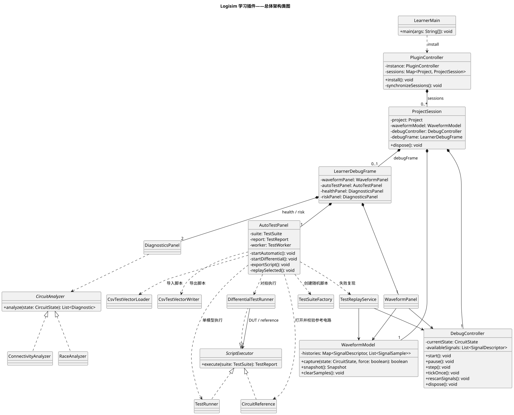
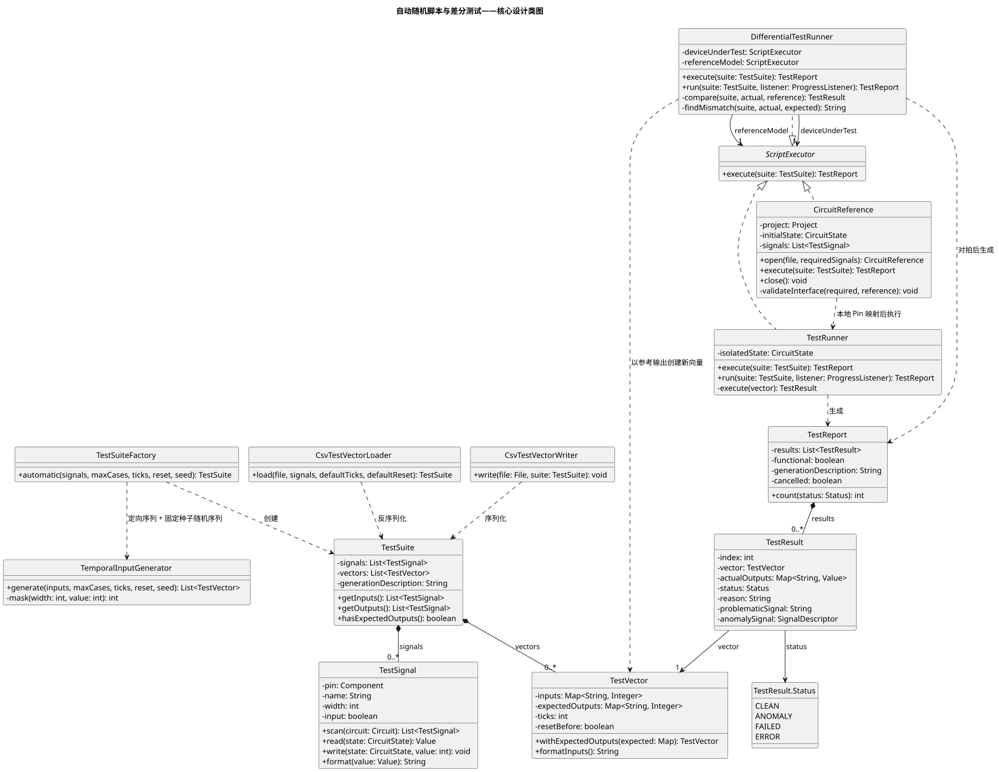
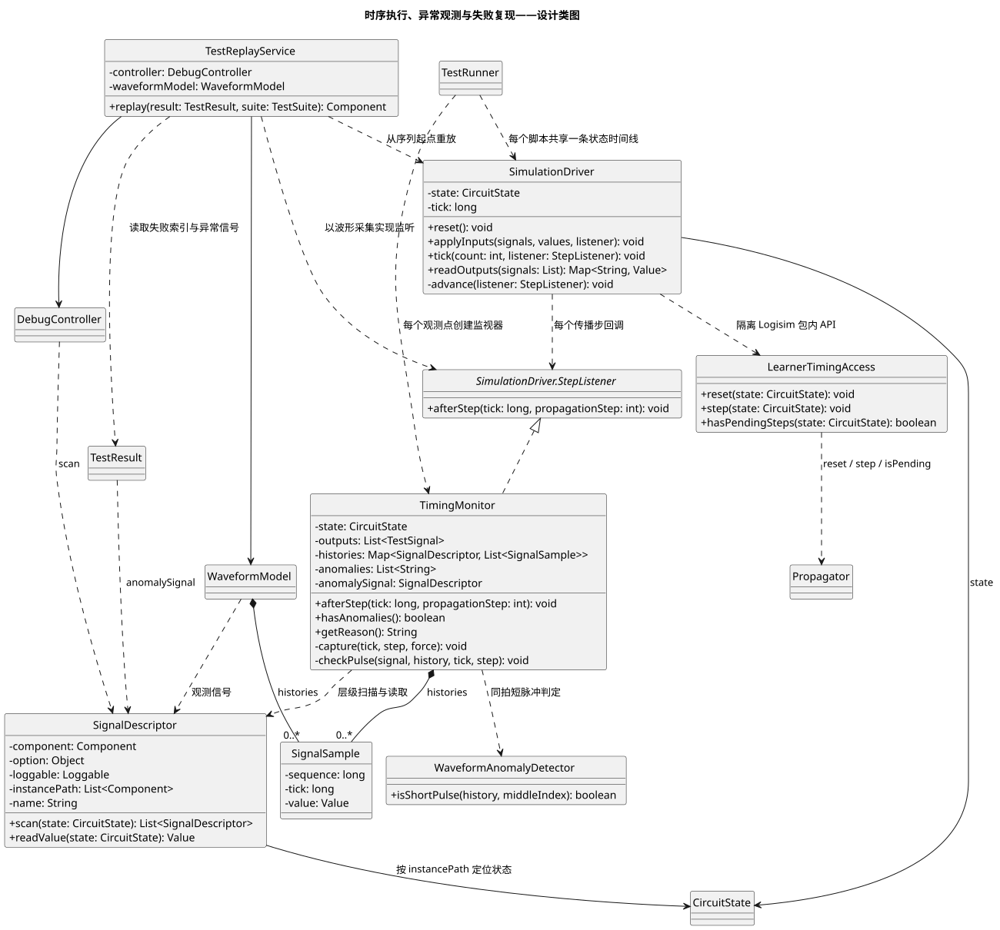
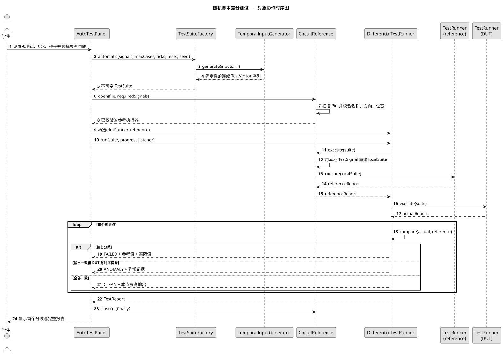
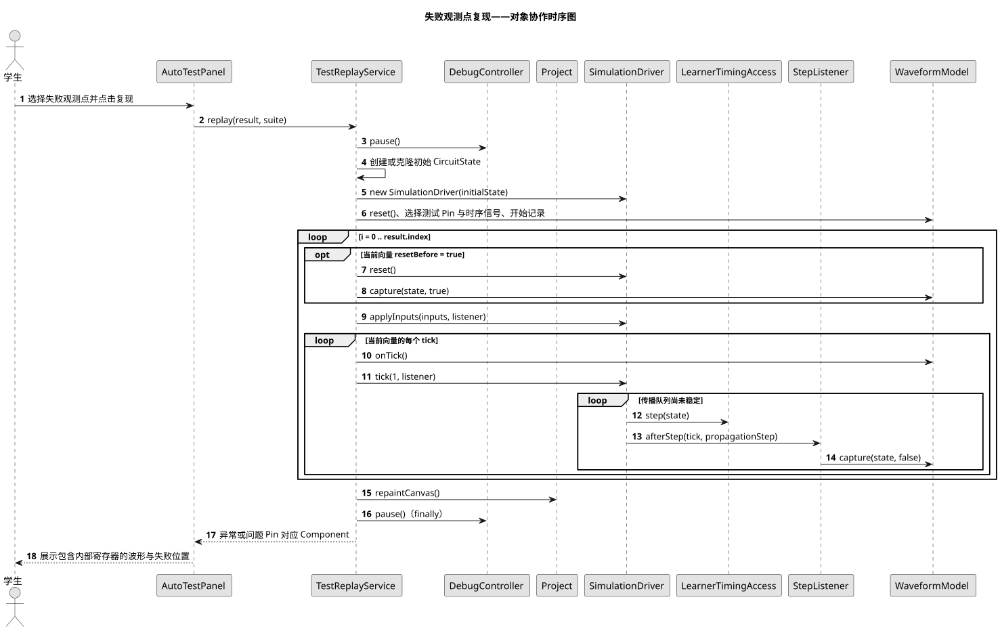

# Logisim 学习插件面向对象设计总考量

## 1. 文档目的与设计定位

本文对应当前 Java 实现，说明 Logisim 学习插件的情景、对象、职责、协作关系和设计权衡，用于面向对象课程汇报、代码评审和后续维护。

本项目不是单纯的波形查看器，也不是某一 CPU 指令集的硬编码解释器，而是一个**面向时序电路的自动测试与差分验证插件**。其核心链路为：

> 不可变测试脚本 → DUT 与参考模型分别执行 → 逐观测点对拍 → 报告首个分歧 → 从脚本起点复现波形

输入包括 DUT `.circ`、参考 `.circ`、观测点数量、每点 tick、随机种子和 CSV 脚本；输出包括逐点测试报告、E/x 与同拍短脉冲证据、可复现脚本和内部时序信号波形。

设计优先级为：

1. **语义正确**：尊重 Logisim 自身的时钟和传播语义。
2. **结果可复现**：同一种子、同一脚本、同一初始状态得到同一轨迹。
3. **职责清晰**：生成、执行、比较、持久化、复现分别由不同对象承担。
4. **变化局部化**：替换参考模型、增加生成策略或调整 UI 时，尽量不重写其他模块。
5. **证据可检查**：测试结果必须给出观测点、参考值、实际值和异常位置，而非只给出“通过”。

## 2. 系统边界与质量目标

### 2.1 当前边界

- 支持顶层输入 Pin 的连续驱动和顶层输出 Pin 的逐点比较。
- 支持子电路内部的寄存器、其他时序元件、Probe 和输出 Pin 观测。
- 支持电路对电路对拍；软件 ISA 模型通过 `ScriptExecutor` 扩展，尚未内置 Spike/NEMU 适配器。
- 自动生成的是 Pin 级定向/随机时序脚本，不是 ISA 感知的 ROM 随机程序。
- 检测的是 Logisim 数字事件语义下的行为，不证明真实芯片的建立时间、保持时间或纳秒级物理时序正确性。

### 2.2 质量目标

| 质量属性 | 设计回应 |
|---|---|
| 正确性 | 复用 Logisim `Propagator`，不自行发明一套门级传播规则 |
| 可复现性 | 固定种子、不可变脚本、CSV 往返、从序列起点复现 |
| 可维护性 | 小接口、服务对象分离、组合优于继承、依赖指向抽象 |
| 可扩展性 | 新参考模型实现 `ScriptExecutor`，新生成策略独立于执行器 |
| 可测试性 | 参考自对拍、已知缺陷注入、接口拒绝、边界输入、回归测试 |
| 资源安全 | 参考电路实现 `AutoCloseable`，后台任务在 `finally` 中关闭资源 |
| 界面响应 | 测试在 `SwingWorker` 后台执行，以中断标记支持取消 |

## 3. 情景驱动的对象分析

### 3.1 参与者与外部系统

| 参与者/系统 | 在情景中的角色 |
|---|---|
| 学生/电路设计者 | 配置脚本、选择参考电路、查看失败、导出脚本、启动复现 |
| DUT | 被测 Logisim 电路，接受同一输入序列并产生实际输出 |
| 参考模型 | 当前为另一份接口兼容的 `.circ`；未来可为软件 ISA 模型 |
| Logisim 2.7.1 | 提供电路、Pin、时钟、传播队列、可观测元件和仿真状态 |
| CSV 文件 | 测试脚本的持久化形式，与导入功能共用同一格式 |

### 3.2 “对象—情景—特性”矩阵

| 情景 | 主要对象 | 必须表现出的特性 | 对应设计 |
|---|---|---|---|
| 生成连续随机脚本 | `TestSuiteFactory`、`TemporalInputGenerator`、`TestSuite`、`TestVector` | 固定种子可复现；相邻状态有意义；脚本不被执行过程修改 | 工厂与生成器分离；值对象不可变 |
| 执行单电路时序测试 | `TestRunner`、`SimulationDriver`、`TestSignal` | 同一状态时间线连续推进；输入、tick、输出顺序固定 | 一个脚本共享一个 `SimulationDriver` |
| 观察瞬态与内部状态 | `TimingMonitor`、`SignalDescriptor`、`SignalSample` | 能看到稳定后消失的脉冲；能区分子电路实例 | `StepListener` 回调；层级路径寻址 |
| 运行随机对拍 | `DifferentialTestRunner`、`ScriptExecutor`、`CircuitReference` | DUT 与参考独立执行；同一脚本；逐点比较；参考可替换 | Scoreboard 依赖抽象而非具体电路 |
| 导出并重新导入脚本 | `CsvTestVectorWriter`、`CsvTestVectorLoader` | 输入、预期、tick、reset 完整往返；格式只有一套 | 读写器分离但共享 `TestSuite` 契约 |
| 复现失败观测点 | `TestReplayService`、`SimulationDriver`、`WaveformModel` | 不从孤立失败行开始；恢复所有前序状态；保留内部寄存器 | 从索引 0 重放到失败索引 |
| 取消后台任务 | `AutoTestPanel.TestWorker`、`TestRunner`、`CircuitReference` | 可中断；不泄漏参考仿真器；不阻塞 Swing EDT | 后台执行、中断检查、`finally close` |

## 4. 典型情景及其后置条件

### 4.1 UC-01：随机脚本差分测试

**触发**：学生设置观测点、每点 tick、种子，并选择参考电路。

**协作对象**：`AutoTestPanel`、`TestSuiteFactory`、`TemporalInputGenerator`、`CircuitReference`、`DifferentialTestRunner`、两个 `TestRunner`。

**主流程**：

1. 工厂创建不可变 `TestSuite`；生成器按固定种子产生定向跳变和随机连续输入。
2. `CircuitReference.open` 扫描参考电路，并校验 Pin 名称、方向和位宽。
3. 对拍器先把脚本交给参考执行器，再交给 DUT 执行器。
4. 两个执行器分别产生 `TestReport`；参考执行器先重建本地 Pin 映射，避免把 DUT 的 Pin 对象误用于参考电路。
5. 对拍器按相同观测点索引比较全部输出，将参考输出写入新的 `TestVector`，再形成 `TestResult`。
6. UI 展示首个分歧；后台任务结束时关闭参考仿真器。

**后置条件**：报告包含每个已执行观测点的状态、输入、参考输出、实际输出和原因；原脚本保持不变。

**备选流**：

- 接口不兼容：在运行前拒绝，不产生无意义的对拍结果。
- 参考执行错误或参考输出为 E/x：标记 `ERROR`，不能把未知值当作金色答案。
- DUT 输出分歧：标记 `FAILED`，给出参考值和实际值。
- 输出一致但存在传播异常：保留 `ANOMALY`，不能因对拍一致而吞掉毛刺证据。
- 用户取消：保留已产生结果，报告取消状态，并释放参考资源。

### 4.2 UC-02：最终输出稳定，但传播中出现毛刺

**触发**：输入变化后，某信号在一个 tick 内经历“原值 → 瞬态值 → 原值”。

**协作对象**：`SimulationDriver`、`LearnerTimingAccess`、`TimingMonitor`、`SignalDescriptor`、`WaveformAnomalyDetector`。

**主流程**：驱动器每次只推进一个传播步；监听器读取当前信号；监视器保存变化历史并识别同拍短脉冲。

**后置条件**：即使最终输出恢复为正确值，也返回 `ANOMALY`，并记录 tick、传播步、瞬态值和信号路径。

**设计考量**：对拍和毛刺检测是两种不同职责。对拍只比较观测点，毛刺检测才观察传播中间态，不能混为一谈。

### 4.3 UC-03：导出并重新导入随机脚本

**触发**：学生点击“导出脚本 CSV”。

**后置条件**：CSV 中的输入、预期输出、tick 和 reset 与内存脚本一致；重新导入后可再次单测、对拍或复现。固定种子用于重新生成，CSV 用于精确保存已经生成的脚本，两者职责不同。

### 4.4 UC-04：复现某个失败观测点

**触发**：学生选择一条失败结果并点击复现。

**主流程**：暂停交互仿真，准备初始状态，选择测试 Pin 与时序观测信号，从脚本索引 0 依次执行到失败索引，并在每个传播步采集波形。

**后置条件**：复现过程执行到达失败点前的全部脚本，并保留内部寄存器波形，而不是只显示失败行的瞬时输入输出；波形显示仍受现有每信号 2000 个采样点的上限约束。

## 5. 总体架构与依赖方向

| 层次 | 代表对象 | 主要职责 | 允许的依赖方向 |
|---|---|---|---|
| 启动与会话 | `LearnerMain`、`PluginController`、`ProjectSession` | 安装插件、管理 Project 生命周期 | 依赖 UI 和调试控制器 |
| 表现层 | `LearnerDebugFrame`、`AutoTestPanel`、`WaveformPanel` | 接收操作、展示结果、组装服务 | 依赖应用服务，不承担传播算法 |
| 应用服务 | `TestRunner`、`DifferentialTestRunner`、`TestReplayService` | 执行用例、对拍、复现 | 依赖脚本抽象和 Logisim 状态 |
| 脚本与结果模型 | `TestSuite`、`TestVector`、`TestReport`、`TestResult` | 保存输入、预期、输出和状态 | 尽量不与 Swing 耦合 |
| 引擎适配 | `SimulationDriver`、`LearnerTimingAccess`、`TestSignal` | 隔离 Logisim 的时钟、传播和 Pin API | 集中承担版本相关依赖 |
| 观测与调试 | `TimingMonitor`、`SignalDescriptor`、`WaveformModel` | 层级读取、异常检测、波形保存 | 通过监听回调接受执行事件 |
| 静态辅助分析 | `ConnectivityAnalyzer`、`RaceAnalyzer` | 连线健康和结构风险提示 | 不作为自动对拍的正确性判据 |

依赖规则是：**高层对拍逻辑依赖 `ScriptExecutor`；Logisim 内部 API 集中在适配器；UI 负责组装而不是实现仿真。**

`TestReplayService` 是应用服务与交互调试之间的桥，它依赖 `DebugController` 和 `WaveformModel`，属于有意的边界连接，不应再把这种依赖扩散到生成器或对拍器。

图 1：总体架构类图。可编辑源文件见 [01-总体架构类图.puml](uml/01-总体架构类图.puml)。

## 6. 对象分类与职责

### 6.1 对象分类

- **值对象**：`TestVector`、`TestReport`、`TestResult`、`SignalSample`。它们保存一次执行或观测的值语义，并通过不可变集合防止事后修改。
- **脚本聚合**：`TestSuite` 聚合信号模式和观测点序列，是各执行器共同接受的输入契约。
- **应用服务**：`TestRunner`、`DifferentialTestRunner`、`TestReplayService`。它们不代表某个电路元件，而是完成一个完整用例。
- **工厂**：`TestSuiteFactory` 负责脚本创建；`CircuitReference.open` 负责构造已加载、已校验的参考对象。
- **适配器**：`CircuitReference` 适配另一份电路及其 Pin；`SimulationDriver` 适配 Logisim 传播；`SignalDescriptor` 适配层级可观测信号。
- **控制器**：`AutoTestPanel` 处理测试界面事件；`DebugController` 处理交互仿真控制。
- **观察接口**：`SimulationDriver.StepListener`、`ScriptExecutor.ProgressListener`、`WaveformModel.Listener` 将事件通知与具体处理分离。

### 6.2 核心对象的单一变化原因

| 对象 | 职责 | 最合理的变化原因 |
|---|---|---|
| `TestSuite` | 保存信号模式和连续观测点 | 脚本契约变化 |
| `TestVector` | 保存一个观测点的输入、预期、tick、reset | 观测点值语义变化 |
| `TestSignal` | 顶层 Pin 的扫描、读取、写入和格式化 | Logisim Pin 契约变化 |
| `TemporalInputGenerator` | 生成定向及随机连续输入 | 激励分布或覆盖策略变化 |
| `TestRunner` | 在一条状态时间线上执行单电路脚本并形成结果 | 单模型执行流程变化 |
| `CircuitReference` | 加载、校验、适配并关闭参考电路 | 参考电路来源或接口规则变化 |
| `DifferentialTestRunner` | 对齐两个报告并识别输出分歧 | 对拍规则变化 |
| `SimulationDriver` | 按输入、tick、传播步推进 Logisim 状态 | 时钟或传播控制方式变化 |
| `TimingMonitor` | 识别 E/x、同拍短脉冲并保存证据 | 时序异常定义变化 |
| `SignalDescriptor` | 通过层级实例路径定位并读取信号 | 子电路寻址方式变化 |
| `TestReplayService` | 从序列起点重建失败现场 | 复现策略变化 |
| `CsvTestVectorLoader/Writer` | 脚本与 CSV 之间转换 | 持久化格式变化 |

这张表也是高内聚的评审依据：如果一次需求变化需要同时修改生成器、Scoreboard、CSV 和 UI，通常说明职责重新发生了混杂。

## 7. 核心设计类图

### 7.1 自动对拍核心

图 2：自动对拍核心设计类图。可编辑源文件见 [02-自动对拍核心类图.puml](uml/02-自动对拍核心类图.puml)。

关键关系：

- `DifferentialTestRunner` 持有两个 `ScriptExecutor`，而不是持有两个 `TestRunner`。因此参考侧可以由不同实现替换。
- `CircuitReference` 在执行前创建带本地 `TestSignal` 的 `TestSuite`，解决“脚本值相同、Pin 所属电路不同”的适配问题。
- `TestResult` 关联新的 `TestVector`，以保存参考输出；原输入脚本不被修改。
- `TestReport` 聚合多个 `TestResult`；组合表示逻辑生命周期聚合，不表示 Java 中需要手动释放这些值对象。

### 7.2 时序执行与观测

图 3：时序执行、异常观测与失败复现设计类图。可编辑源文件见 [03-时序执行与观测类图.puml](uml/03-时序执行与观测类图.puml)。

关键关系：

- `TestRunner` 在一个脚本内复用一个 `SimulationDriver`，保持状态连续。
- `SimulationDriver` 通过 `StepListener` 通知传播步，不知道毛刺如何判定。
- `TimingMonitor` 实现监听接口，独立负责异常定义和证据去重。
- `LearnerTimingAccess` 是唯一访问 Logisim 包内传播操作的适配点，限制版本耦合的扩散。
- `TestReplayService` 复用同一驱动器，避免“正式测试”和“复现”使用两套时间语义。

## 8. 对象协作时序

### 8.1 随机对拍

图 4：随机脚本差分测试时序图。可编辑源文件见 [04-随机对拍时序图.puml](uml/04-随机对拍时序图.puml)。

当前采用“完整轨迹执行后比较”：先得到参考报告，再得到 DUT 报告，最后按索引比较。它不要求两个实现逐传播步锁同步，因此允许参考电路与 DUT 具有不同微结构和内部延迟。

### 8.2 失败复现

图 5：失败观测点复现时序图。可编辑源文件见 [05-失败复现时序图.puml](uml/05-失败复现时序图.puml)。

复现依赖“初始状态 + 完整前缀脚本”，而不是只保存失败行。这是时序测试与组合逻辑测试的本质区别。

## 9. 高内聚、低耦合与 SOLID 的落实

| 原则 | 在本设计中的具体体现 | 直接收益 |
|---|---|---|
| 单一职责 SRP | 生成、执行、对拍、序列化、复现分别由不同对象承担 | 修改一个情景时减少连锁修改 |
| 开闭原则 OCP | 新参考模型实现 `ScriptExecutor` 即可进入既有对拍流程 | 无需修改 Scoreboard |
| 里氏替换 LSP | 所有执行器接受同一 `TestSuite` 并返回 `TestReport`；参考适配器保证本地 Pin 语义 | 替换实现不会破坏脚本契约 |
| 接口隔离 ISP | `ScriptExecutor` 只有执行契约；传播监听和进度监听是独立小接口 | 实现者不必承担无关方法 |
| 依赖倒置 DIP | `DifferentialTestRunner` 依赖抽象执行器，不依赖具体电路类型 | 高层对拍规则更稳定 |
| 封装 | `TestVector` 和结果对象使用只读集合；`withExpectedOutputs` 创建新对象 | 防止参考输出污染原脚本 |
| 组合优于继承 | 对拍器组合两个执行器；复现服务组合驱动器与波形模型 | 避免为 DUT、参考、对拍建立脆弱继承树 |
| DRY | 单测、参考执行和复现复用 `SimulationDriver`；波形和监视器复用 `SignalDescriptor` | 避免时间语义和层级寻址出现多套实现 |

高内聚不意味着“类中代码越少越好”，而是同一类中的字段和方法共同服务一个变化原因。低耦合也不意味着“没有依赖”，而是依赖尽量指向稳定契约，并集中在明确的组装点和适配点。

## 10. GRASP 职责分配的对应关系

| GRASP 原则 | 项目中的例子 |
|---|---|
| 信息专家 | `TestSignal` 最了解 Pin 的读写；`SignalDescriptor` 最了解层级信号定位；`TestVector` 最了解单个观测点的数据 |
| 创建者 | `TestSuiteFactory` 创建脚本；`TestRunner` 创建驱动器和监视器；`CircuitReference.open` 创建完整参考对象 |
| 控制器 | `AutoTestPanel` 处理 UI 用例；`TestRunner` 控制单模型脚本执行；`DifferentialTestRunner` 控制对拍用例 |
| 多态 | DUT、参考电路和对拍器都实现 `ScriptExecutor`；`TimingMonitor` 通过 `StepListener` 接收事件 |
| 纯虚构 | `DifferentialTestRunner`、`TestReplayService` 不是电路实体，而是为低耦合引入的应用服务 |
| 间接性 | `CircuitReference` 隔离另一份电路的加载和 Pin 差异；`LearnerTimingAccess` 隔离 Logisim 包内 API |
| 防止变异 | 参考模型通过接口变化；Logisim 版本相关操作集中在适配器；CSV 读写与执行逻辑分离 |

这些原则不是额外的模式清单，而是对第 3 节情景中“为什么由这个对象做这件事”的回答。

## 11. 关键设计权衡

| 决策 | 得到的收益 | 付出的代价与限制 |
|---|---|---|
| 复用 Logisim `Propagator` | 时钟、元件和传播行为与真实电路一致 | 需要访问包内 API，依赖 Logisim 2.7.1；通过 `LearnerTimingAccess` 限制影响范围 |
| 对拍比较观测点而非传播步 | 允许参考模型与 DUT 微结构不同 | 不能靠对拍发现所有瞬态问题，故保留独立 `TimingMonitor` |
| 先运行完整参考轨迹，再运行 DUT 轨迹 | 算法简单、双方独立、无锁同步耦合 | 需要保存完整报告；超长轨迹未来可改为流式比较 |
| 脚本和结果采用不可变值对象 | 复现、后台执行和报告生成更安全 | 需要复制 Map/List；教学规模下该成本可接受 |
| 导入导出不新增格式 | 降低学习和维护成本，便于验证往返一致性 | CSV 对复杂层次断言的表达能力有限 |
| 不硬编码 CPU ISA 规则 | 核心保持通用，避免把某个课程 CPU 的假设扩散到框架 | 用户必须提供参考模型和可比较的输出 Pin |
| UI 作为组合根 | 减少额外框架和层次，适合课程项目规模 | `AutoTestPanel` 仍偏大；只有继续增加工作流时才值得抽取应用控制器 |

## 12. 运行契约、异常与资源管理

### 12.1 时间与状态契约

- 一行 `TestVector` 是一个观测点，包含输入、预期输出、tick 数和是否先复位。
- 一个脚本使用一条连续状态时间线；后续观测点继承前序寄存器状态。
- `reset` 清除电路状态，但不倒退全局测试时间。
- 默认自动脚本只在首点复位；CSV 可通过显式 `reset` 列在其他点复位。
- tick 是 Logisim 时钟相位单位，不等同于纳秒，也不自动等同于完整周期；常见完整周期可配置为 2 tick。

### 12.2 接口与比较契约

- DUT 和参考电路的顶层 Pin 必须同名、同方向、同位宽，数量也必须一致。
- 对拍比较每个观测点的全部输出；参考输出缺失或为 E/x 时结果为 `ERROR`。
- CPU 对拍应显式暴露提交 PC、提交指令、写回寄存器及写回数据等体系结构信息。
- 参考自对拍一致只能证明执行确定性，不能证明参考模型本身正确；参考模型还需要定向已知答案验证。

### 12.3 状态隔离契约

- DUT 在隔离的 `CircuitState` 上执行，参考电路拥有独立 `Project` 和本地 Pin 映射。
- `TestSuite` 在执行过程中保持值语义不变，避免两个执行器互相污染输入。
- 如果首点不复位，保留调用方选择的当前状态语义，不宣称测试一定从零状态开始。

### 12.4 状态分类

| 状态 | 含义 |
|---|---|
| `CLEAN` | 未发现异常；若有预期或参考输出，则本点输出一致 |
| `ANOMALY` | 出现 E/x、同拍短脉冲、振荡等时序异常 |
| `FAILED` | 本点实际输出与预期或参考输出不一致 |
| `ERROR` | 执行异常、超时，或参考模型无法提供可信答案 |

### 12.5 线程与资源契约

- 测试在 `SwingWorker` 后台执行，避免阻塞 Swing 事件分派线程。
- `TestRunner` 在观测点和传播步检查中断标记，对拍器在比较阶段检查中断标记。
- `CircuitReference` 拥有自己创建的 `Project`，因此负责关闭其 `Simulator`；DUT 侧不能关闭学生正在使用的 Logisim 仿真器。
- UI 在 `finally` 中调用 `CircuitReference.close`，包括取消和异常路径。

## 13. 验证证据与工程含义

| 验证项 | 已观察结果 | 能证明什么 |
|---|---|---|
| 项目构建 | `build.bat` 成功 | 源码可编译并生成插件 JAR |
| 固定种子 | 同种子脚本逐点一致 | 随机生成具有可复现性 |
| CSV 往返 | 64 个观测点输入、预期、tick、reset 一致 | 脚本持久化未丢失关键语义 |
| 参考自对拍 | 64/64 点一致 | 执行器和对拍器具有确定性 |
| 随机差分测试 | 第 4 点发现 `ACC` 参考 `00`、实际 `FF` | 能定位首个可见功能分歧 |
| 失败复现 | 保留 `IDEX_ACC` 等内部寄存器波形 | 复现能解释流水线状态，而非只重放最终输出 |
| 寄存器沿测试 | 连续输入对应输出 `1、1、2` | 时钟边沿与状态继承正确 |
| 毛刺测试 | 最终输出为 0，仍报告传播步中的瞬态 1 | 监视器不被稳定后的正确输出欺骗 |
| 组合逻辑回归 | 32/32 点无异常 | 新时序主链路未破坏原组合测试场景 |

验证还存在边界：这些结果证明实现与所设计样例一致，不等于对所有 Logisim 电路或所有 CPU ISA 的正确性作出证明。

## 14. 可维护性边界与扩展规则

### 14.1 当前有意保留的限制

- `AutoTestPanel` 同时承担较多界面组装工作，但传播、对拍和序列化算法已不在其中；只有新增更多工作流时才建议抽取 `AutoTestController`，避免为分层而分层。
- `ScriptExecutor` 的结果契约仍使用 Logisim `Value` 和 Pin 名称。软件 ISA 适配器需要把提交轨迹转换为该结果契约，而不是让 Scoreboard 直接理解某个 ISA。
- 当前对拍保存完整报告，适合教学规模。只有 profiling 证明内存或进度反馈成为问题时，才应改为流式比较。
- `LearnerTimingAccess` 使用 Logisim 2.7.1 包内语义，升级 Logisim 时必须重新验证这一适配点。

### 14.2 扩展时应遵守的规则

1. **接入软件 ISA 参考模型**：新增 `ScriptExecutor` 实现和结果适配，不修改 `DifferentialTestRunner`。
2. **增加 ISA 感知随机程序生成**：新增生成策略或工厂方法，不把指令生成逻辑写入执行器或 UI。
3. **增加文件格式**：新增序列化器，不破坏既有 CSV 契约。
4. **增加异常类型**：优先扩展 `TimingMonitor` 的判定逻辑，不让 Scoreboard 学习门级毛刺规则。
5. **增加 UI 工作流**：先评估 `AutoTestPanel` 是否已出现多个独立变化原因，再决定是否抽取控制器。
6. **升级 Logisim**：先验证 `LearnerTimingAccess`、`TestSignal` 和 `SignalDescriptor` 三个适配点，再运行全部时序回归。

## 15. 课程汇报的主线

可以用以下五句话概括本设计：

1. 组合逻辑测试无法覆盖状态继承、跨拍依赖和瞬态行为，因此本项目把基本测试单位改为连续时序脚本。
2. 随机对拍情景要求 DUT 和参考模型共享脚本但独立执行，因此引入小型 `ScriptExecutor` 抽象和独立 Scoreboard。
3. 通过值对象、工厂、适配器、应用服务和监听接口分配职责，使生成、执行、比较、持久化和复现能够独立变化。
4. 复用 Logisim 传播内核保证语义一致，同时用适配器控制版本耦合；对拍只看稳定观测点，毛刺则由独立监视器处理。
5. 固定种子、CSV 往返、自对拍、已知缺陷和失败波形共同构成验证证据；参考模型正确性和物理时序仍属于明确的系统边界。

## 16. 图纸索引

| 图纸 | 可编辑源文件 | SVG | PNG |
|---|---|---|---|
| 总体架构类图 | [PUML](uml/01-总体架构类图.puml) | [SVG](uml/01-总体架构类图.svg) | [PNG](uml/01-总体架构类图.png) |
| 自动对拍核心类图 | [PUML](uml/02-自动对拍核心类图.puml) | [SVG](uml/02-自动对拍核心类图.svg) | [PNG](uml/02-自动对拍核心类图.png) |
| 时序执行与观测类图 | [PUML](uml/03-时序执行与观测类图.puml) | [SVG](uml/03-时序执行与观测类图.svg) | [PNG](uml/03-时序执行与观测类图.png) |
| 随机对拍时序图 | [PUML](uml/04-随机对拍时序图.puml) | [SVG](uml/04-随机对拍时序图.svg) | [PNG](uml/04-随机对拍时序图.png) |
| 失败复现时序图 | [PUML](uml/05-失败复现时序图.puml) | [SVG](uml/05-失败复现时序图.svg) | [PNG](uml/05-失败复现时序图.png) |
